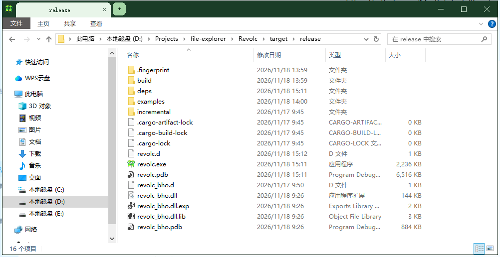

<p align="center">
  
</p>

<h1 align="center">Revolc</h1>

<p align="center">把 Windows 资源管理器变成多标签浏览器<br><sub>Clover 的原生重制版 · 不内嵌浏览器内核</sub></p>

<p align="center">
  
  
  
</p>



---

## 先说 Clover

如果你用过三叶草（Clover），应该懂那种感觉：用完之后再也回不去原生资源管理器了。

它做的事其实很朴素——把浏览器那套交互搬到文件管理上：一个窗口开多个标签、双击文件夹在新标签里打开、`Ctrl+W` 关掉、拖动标签换位置。没有花活，但每一处都恰好是天天要用的那一下。

可惜它早就停更了。后来的系统一个比一个难缠，装上去要么打不开，要么把 explorer 弄崩。

所以有了 Revolc：**把 Clover 那股劲儿重做一遍，但换成这个年代该有的实现方式。**

## 继承了 Clover 的什么

- 文件夹在标签里打开，不再糊一屏窗口
- `Ctrl+T` 新建、`Ctrl+W` 关闭、中键点掉、拖动标签重排
- 窗口关了不退出，缩进托盘继续接管
- **接管的是真实的 Explorer 窗口**

最后一条是重点。Revolc 不是自绘一个"像资源管理器"的文件列表——你看到的 Ribbon、地址栏、右键菜单、预览窗格、详情列，以及系统里装的所有 shell 扩展，**全都是原生组件**。所以它不会慢，也不会有"这个右键菜单怎么少了一半功能"的尴尬。

## 改变了什么

|  | Clover | Revolc |
|---|---|---|
| 技术栈 | 内嵌一整份 Chromium（2011 年的） | Rust + 原生 Win32，没有浏览器内核 |
| 体积 | 几十 MB，外加一串子进程 | 一个 exe（约 2 MB）+ 一个很小的 BHO DLL |
| 接管方式 | 注入进程、装 hook、子类化窗口 | BHO 只发一条消息，主程序自己把窗口搬进来 |
| 退出后 | 卸载 / 注销 | 注销 BHO，系统 100% 原样 |
| 标题栏 | Chromium 自绘 | 一体化标题栏，标签条本身就是标题栏 |

具体说三件事：

**不注入、不 hook、不改 Explorer 的代码。** BHO 的作用只有一个：在新窗口创建时喊一声。剩下的判断、搬运、排布，全部由 Revolc 自己完成。这条路线最慢的部分是调试，但换来的是崩溃面的数量级下降。

**吸收靠双通道。** 通知会丢，所以除了 BHO 的提示，还有一个自适应的后台扫描兜底（空闲时 5 次/秒，预期有窗口时 66 次/秒）。单次扫描是亚毫秒级的，正常使用察觉不到。

**一切都可撤销。** 配置文件在 `%APPDATA%\revolc\revolc.toml`，改完即时生效；接管模式随时能切成 `off`；退出请走托盘菜单或 `revolc.exe --shutdown`，被接管的窗口会原样回到桌面。

## 现在能用到什么程度

可以日常用。已知的毛病，不藏着：

- 开关标签时原生窗口会闪一下 —— re-parent 架构的固有代价，Clover 当年同款
- **别用任务管理器强杀**。被接管的文件夹窗口是 Revolc 的子窗口，会一起没掉。请走托盘退出
- 多窗口共存、启动时恢复上次的标签，还没做
- Windows 11 上的圆角、贴靠布局、多显示器 DPI 还在打磨

## 自己编译

需要 Rust + MSVC 工具链和 Windows SDK：

```bash
cargo build --release                  # 主程序
cargo build --release -p revolc-bho    # BHO（要单独编，注册才生效）
```

注册方式、排错清单、这一路上踩过的坑，都写在 [`docs/交接文档.md`](docs/交接文档.md) 里——那份文档比我诚实。

## 欢迎搭把手

一个人写 shell 扩展很容易钻牛角尖，所以特别欢迎这几种帮忙：

- **日常用一阵，然后告诉我哪里别扭。** soak 测试比任何单元测试都值钱：反复开关机、注销、强杀之后有没有留下僵尸窗口
- **Windows 11 / 多显示器 / 高 DPI** 上的表现（我这边测不了所有组合）
- **多窗口共存**的设计讨论——这是下一步最大的一块，Clover 在这件事上其实做得不算好，值得重新想
- 托盘菜单、设置界面、安装器

开 issue 就行，附上 `%APPDATA%\revolc\logs\` 里的日志会比截图有用得多。

## 一句免责

它接管的是系统 shell。装之前请读一遍文档，注册表记得备份。真出问题，`docs/registry/` 里有清干净的脚本。

---

<p align="center"><sub>致敬 Clover。那个把文件管理器做对了的工具。</sub></p>
